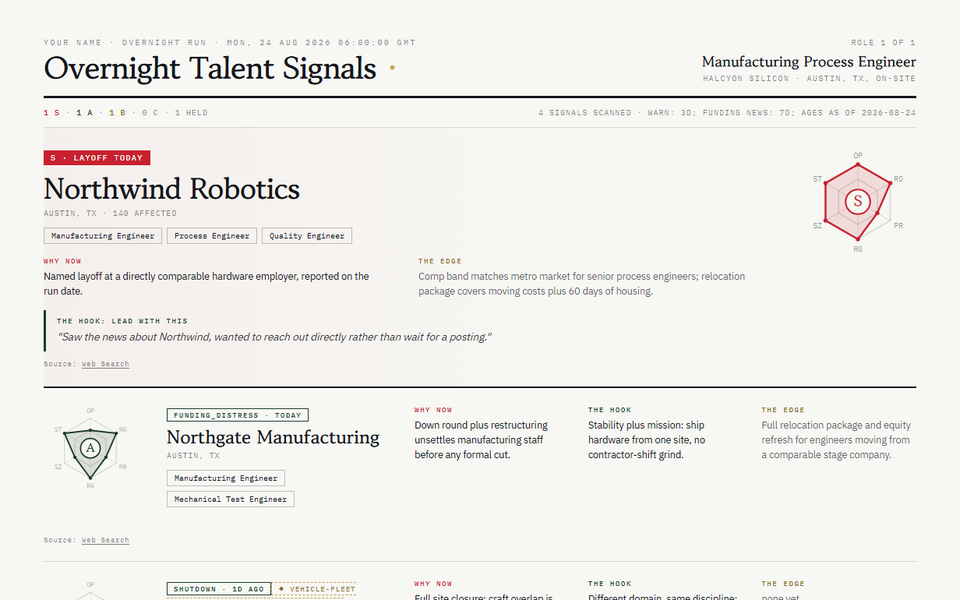
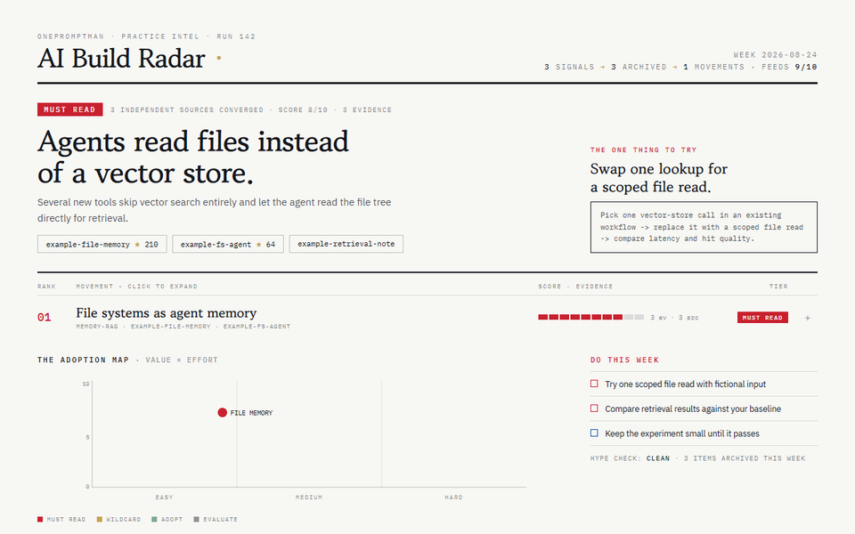
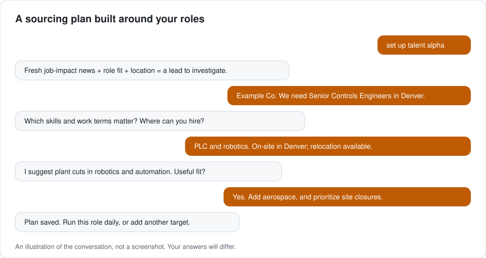
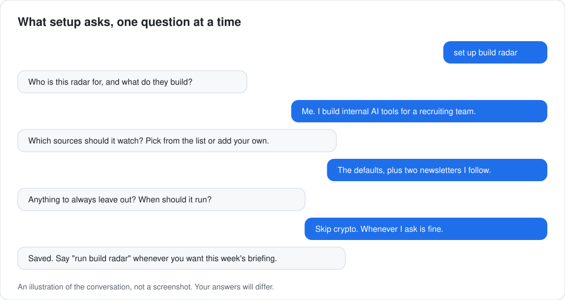
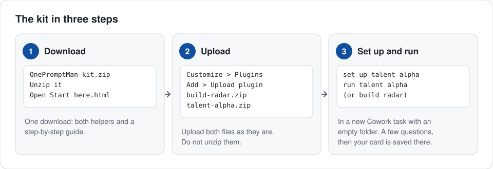

<h1>OnePromptMan kit</h1>

<h3>Set it up once. Get better every week.</h3>

Two Claude helpers that read the news for you. One catches hiring moments while they are still fresh. One cuts a week of AI news down to what is worth trying. Answer a few questions once, then type <code>run</code> whenever you want a fresh card.

NO CODE &nbsp;·&nbsp; NO API KEY &nbsp;·&nbsp; NOTHING IS SENT FOR YOU

  

<table>
<tr>
<td align="center" width="50%">

  FOR PEOPLE WHO HIRE <a href="#talent-alpha-timing-is-the-edge"><b>Talent Alpha</b></a> Timing is the edge
</td>
<td align="center" width="50%">

  FOR PEOPLE WHO BUILD WITH AI <a href="#build-radar-less-news-more-reps"><b>Build Radar</b></a> Less news, more reps
</td>
</tr>
</table>

Sample cards made from fictional companies and data.

## At a glance

| | **Talent Alpha** | **Build Radar** |
|---|---|---|
| **For** | Recruiters, sourcers, hiring managers | Anyone building with AI |
| **The edge** | Timing: reach out while the news is fresh | Filtering: only what has evidence |
| **It reads** | Layoff and funding news, by web search | GitHub and the builder feeds you pick |
| **You get** | A ranked card of companies, why now, and a first line | A short briefing, a one-page card, and one thing to try |
| **How often** | Whenever you ask | Once a week, or whenever you ask |
| **It never** | Names people or contacts anyone | Calls something a trend on one source without saying so |

## Talent Alpha: timing is the edge

**The problem.** A layoff or a bad funding round can make good people open to a move. By the time everyone has heard, every recruiter is calling them.

**What it does.**

- Searches the web for layoff and funding-distress news.
- Grades each company **S, A, B or C** for how well the news fits your open role.
- Gives you **why now**, the **source links** and a **draft first line**.
- Keeps it fresh: layoff news counts for **3 days**, funding news for **7**. Run it again and it shows only what you have not seen.

**What it never does.** It names companies and job functions, never people. It contacts no one. You read the card and decide.

Setup is a short conversation about the role you are hiring for:

## Build Radar: less news, more reps

**The problem.** Read everything and you learn nothing. Read nothing and you fall behind.

**What it does.**

- Once a week, scans GitHub and the builder feeds you choose.
- Throws out what cannot show evidence. Nothing counts as a trend without **two independent sources**, or a clear flag that it has only one.
- Groups what is left into **a few movements**, written for what you build.
- Ends every briefing with **one experiment to try** this week.

**You set the filter.** Tell it what you build and who you build for. It filters for your path, not the feed's.

Setup asks who the briefing is for and what to watch:

## Get started in three steps

1. **Download** the kit and unzip it. Open **Start here.html** for the guide with pictures.
2. **Upload** `talent-alpha.zip` and `build-radar.zip` from the `plugins` folder in the Claude desktop app: **Customize > Plugins > Add > Upload plugin**. Do not unzip these two.
3. **Set up.** Make an empty folder, start a new Cowork task and pick that folder. Type `set up talent alpha` or `set up build radar` and answer a few questions.

Then type `run talent alpha` or `run build radar` whenever you want a fresh one.

**You need:** the Claude desktop app (Windows or Mac) on a paid Claude plan. Talent Alpha also needs web search turned on. Build Radar may ask you to allow some websites; **Start here.html** shows where. No API key, no other account, no code.

## Your data

- What you type goes to Claude, like any chat.
- Your answers and cards are saved only in the folder you choose. Delete the folder to delete them.
- Nothing is emailed or posted.

Both helpers were tested before this release. Mac has not been tried yet. Running them on a timetable is optional: see [Run it on a schedule](schedule/README.md).

Something broke or confused you? [Open an issue](https://github.com/onepromptman/routines/issues) (needs a free GitHub account).

[Release notes](https://github.com/onepromptman/routines/releases/latest) · [Talent Alpha source](https://github.com/onepromptman/talent-alpha) · [Apache 2.0 license](LICENSE) · [Security reporting](SECURITY.md) · © 2026 OnePromptMan
