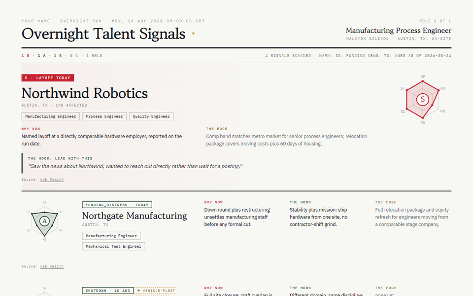
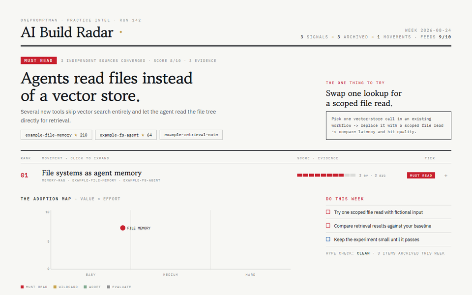
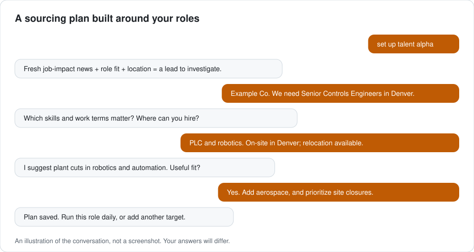
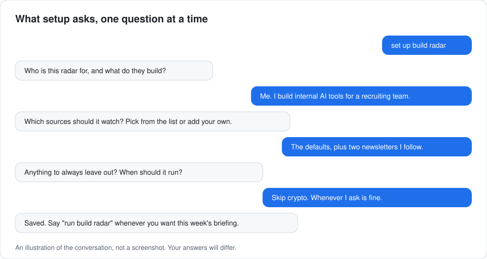
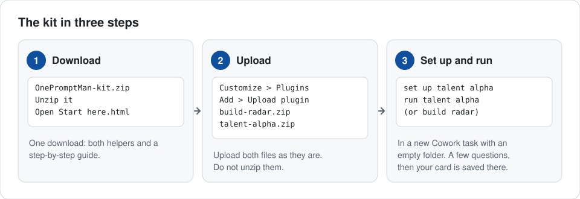

<h1>OnePromptMan kit</h1>

<b>Talent Alpha</b> finds company news relevant to the roles you hire for. <b>Build Radar</b> gives your team a short AI briefing and one thing to try.

THE KIT NEVER CONTACTS ANYONE Cloud scheduling on ChatGPT Dot. Desktop plugins for Claude.

## Choose where to run

- **[Set up in ChatGPT Dot](schedule/chatgpt-dot.md#first-time-setup).** Paste one prompt into Your dot. It checks its cloud computer, asks about your team and what to run, and saves those choices for future runs. Cloud schedules can run while your computer is off.
- **[Set up in Claude Cowork](#get-started-in-claude).** Download the kit and run a short setup conversation for each helper you want. For automatic local runs, follow the [Claude schedule guide](schedule/README.md).

Confirm the team, criteria, and first result before scheduling. When the work changes, update the same saved settings. [Change your Dot setup](schedule/chatgpt-dot.md#change-what-the-routines-track) or rerun the Claude setup command in the same folder.

<table>
<tr>
<td align="center" width="50%">

  FOR PEOPLE WHO HIRE <a href="#talent-alpha-timing-is-the-edge"><b>Talent Alpha</b></a> Timing is the edge
</td>
<td align="center" width="50%">

  FOR PEOPLE WHO BUILD WITH AI <a href="#build-radar-less-news-more-reps"><b>Build Radar</b></a> Less news, more reps
</td>
</tr>
</table>

Sample cards made from fictional companies and data.

## Why these exist

I scaled a startup's talent team from the back foot, always fighting for the best people. You learn to use every advantage you can find. Knowing about a layoff or a big shift in talent isn't enough. You need to know first. That's why I built Talent Alpha.

As a builder, I had the opposite problem: too much news, not enough focus. Build Radar filters the noise down to what's worth trying this week.

Routines is where I keep my scheduled agent tasks. These two are the first.

## At a glance

| | **Talent Alpha** | **Build Radar** |
|---|---|---|
| **It reads** | Layoff and funding news, by web search | GitHub and the builder feeds you pick |
| **You get** | A ranked role-specific card with company signals, sources, and a draft first line | A short briefing and one thing to try, plus a one-page card on Dot or by request in Claude |
| **How often** | Daily on a schedule, or whenever you ask | Weekly on a schedule, or whenever you ask |
| **It never** | Names people or contacts anyone itself | Calls one source a trend without flagging it |

## Talent Alpha: timing is the edge

**The problem.** A layoff or a bad funding round can make good people open to a move. By the time everyone has heard, every recruiter is calling them.

**What it does.**

- Searches the web for layoffs and signs a company is struggling to raise money.
- Grades each company **S, A, B or C** on how well the news fits your open role.
- Gives you **why now**, the **source links** and a **draft first line**.
- Stays fresh: layoff news counts for **3 days**, funding news for **7**. Run it again and you only see what is new.

**Coming in the next kit.** The [Talent Alpha source](https://github.com/onepromptman/talent-alpha#send-the-companies-to-noon-or-juicebox) has a campaign handoff for Noon and Juicebox. It uses your existing job's requirements and targets the companies ranked S and A. Review the results in your sourcing platform.

The card names companies and job functions. Setup asks about your organization, the hiring team, and the roles you want to track. In Dot, a shared schedule can run each approved role in turn and save a separate card and history per role.

## Build Radar: less news, more reps

**The problem.** Read everything and you learn nothing. Read nothing and you fall behind.

**What it does.**

- Scans GitHub and the builder feeds you choose.
- Throws out anything without evidence. Nothing counts as a trend without **two independent sources**, or a flag that it has only one.
- Groups the news into **a few trends**, written for what your team builds.
- Ends every briefing with **one experiment to try** this week.

**You set the filter.** Tell it what you build and who you build for. It filters for your path, not the feed's.

Setup asks who the briefing is for and what to watch:

## Get started in Claude

1. **Download** and unzip the kit, then open **Start here.html**.
2. **Upload** the plugin ZIP you want from the `plugins` folder. In Claude desktop, go to **Customize > Plugins > Add > Upload plugin** and pick the ZIP as downloaded.
3. **Set up.** Start a Cowork task in a new folder. Type `set up talent alpha` or `set up build radar`. Answer the setup questions and confirm where Claude saved your settings. Keep a separate folder for each hiring role you want to schedule.
4. **Try it.** In the same folder, type `run talent alpha` or `run build radar`. Check that the results reflect your role or team's priorities. For the one-page Build Radar card, follow with `make the radar card`.

You need the Claude desktop app (Windows or Mac) on a paid Claude plan. Talent Alpha needs web search. Build Radar may ask for access to your selected news sites. The [Claude scheduling guide](schedule/README.md) covers local schedules and the [requirements for Claude cloud](schedule/README.md#claude-cloud-scheduled-tasks).

## Your data

- What you type goes to the assistant you choose.
- Claude desktop saves files in your chosen folder. Dot uses a folder on its cloud computer for the profile, results, and run history files.
- The current kit keeps the results in your chosen app and files. It does not email, post, or contact candidates.

## Status

Both helpers passed [first-time setup and separate persistence checks on Dot](schedule/chatgpt-dot.md#dot-cloud-test-results). The first-time Talent Alpha test used two fictional hiring scopes with separate profiles and histories. See the [ChatGPT desktop tests](schedule/chatgpt-desktop.md#windows-test-results) and [Claude scheduling status](schedule/README.md) for the local recipes.

**Tell me what breaks.** [Open an issue](https://github.com/onepromptman/routines/issues), or message me on [LinkedIn](https://www.linkedin.com/in/bryanhong) if you don't have a GitHub account.

[Release notes](https://github.com/onepromptman/routines/releases/latest) · [Talent Alpha source](https://github.com/onepromptman/talent-alpha) · [Apache 2.0 license](LICENSE) · [Security reporting](SECURITY.md) · © 2026 OnePromptMan
