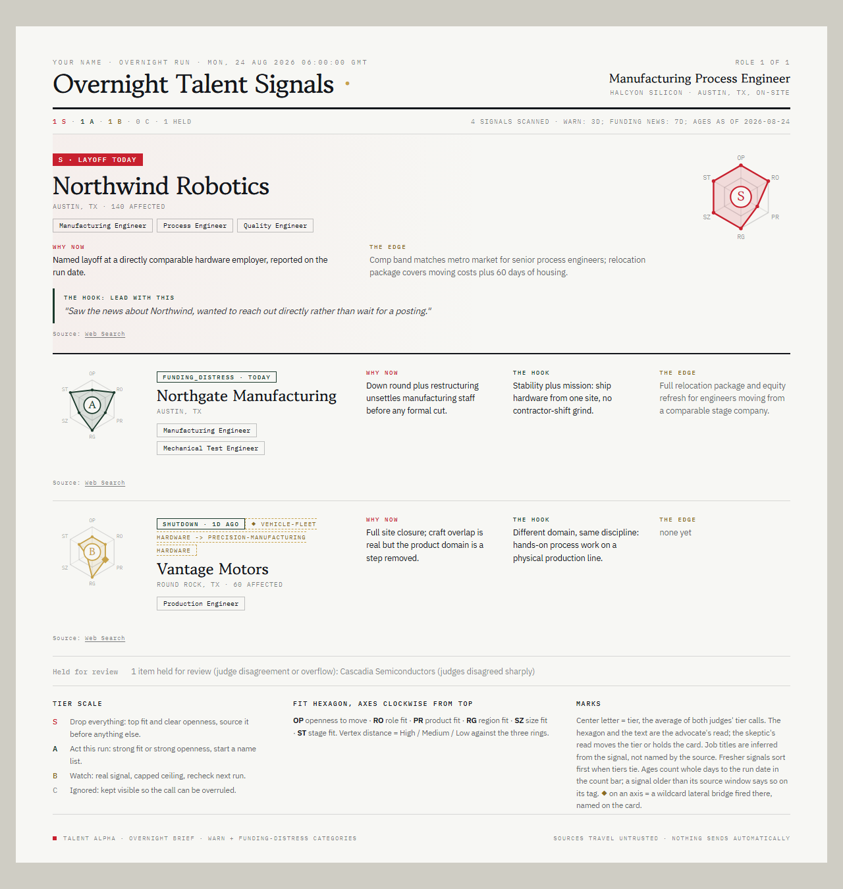
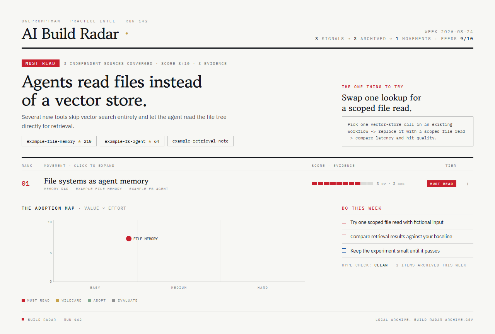
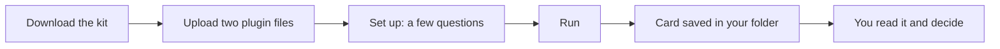

# OnePromptMan kit

Two helpers for the Claude desktop app. No code, no API key.

- **Talent Alpha** tells you which companies just had layoff or funding news that matters for the role you are hiring.
- **Build Radar** tells you each week what people building with AI shipped, and one thing to try.

## Try the kit

1. Click **Download the kit** and unzip it. Open **Start here.html** if you want the guide with pictures.
2. In the Claude desktop app, open **Customize > Plugins > Add > Upload plugin**. Upload `talent-alpha.zip` and `build-radar.zip` from the `plugins` folder. Do not unzip these two.
3. Make an empty folder. Start a new Cowork task and pick that folder. Type `set up talent alpha` or `set up build radar` and answer a few questions.

After that, type `run talent alpha` or `run build radar` whenever you want a fresh one.

**You need:** the Claude desktop app (Windows or Mac) on a paid Claude plan. Talent Alpha also needs web search turned on. Build Radar may ask you to allow some websites; **Start here.html** shows where. No API key, no other account, no code.

## Talent Alpha

A ranked card of companies with fresh layoff or funding news, graded S, A, B or C for how well the news fits your open role. Each company comes with why now, the source links and a draft first line. Run it again another day and it shows only what you have not seen.

It finds news by web search. It names companies and job functions, never people, and it never contacts anyone. You read the card and decide.

Setup is a short conversation about the role you are hiring for:

## Build Radar

A short weekly briefing on what people building with AI shipped, written for what you do, plus a one-page card. Every item links to its sources. Nothing is shown as a trend without two independent sources or a clear single-source flag, and every briefing ends with one thing to try.

Setup asks who the briefing is for and what to watch:

Sample cards are made from fictional companies and data.

## How it works

## Your data

What you type goes to Claude, like any chat. Your answers and cards are saved only in the folder you choose. Delete the folder to delete them. Nothing is emailed or posted.

Both helpers were tested before this release. Mac has not been tried yet. Running them on a timetable is optional: see [Run it on a schedule](schedule/README.md).

Something broke or confused you? [Open an issue](https://github.com/onepromptman/routines/issues) (needs a free GitHub account).

[Release notes](https://github.com/onepromptman/routines/releases/latest) · [Talent Alpha source](https://github.com/onepromptman/talent-alpha) · [Apache 2.0 license](LICENSE) · [Security reporting](SECURITY.md) · © 2026 OnePromptMan
